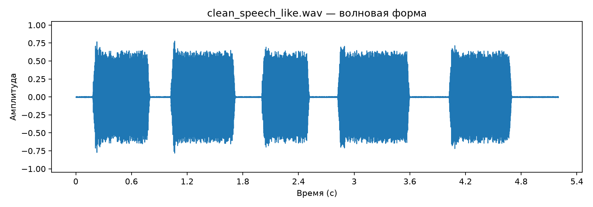
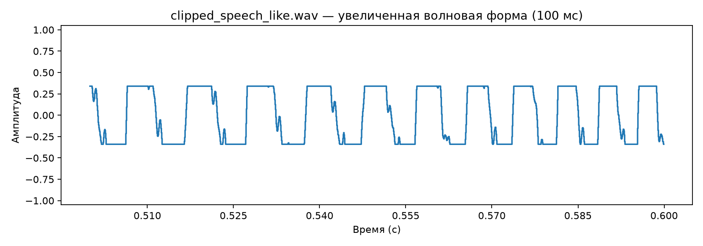
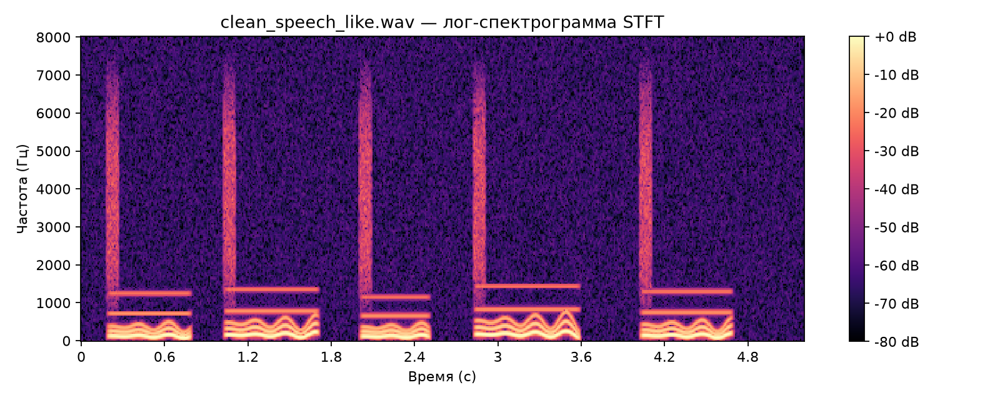
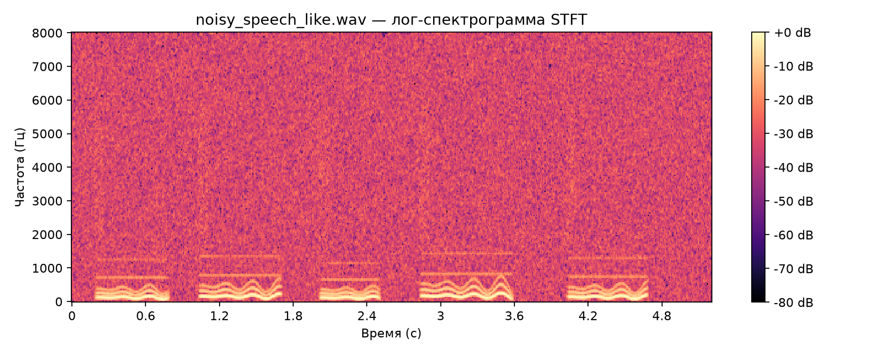
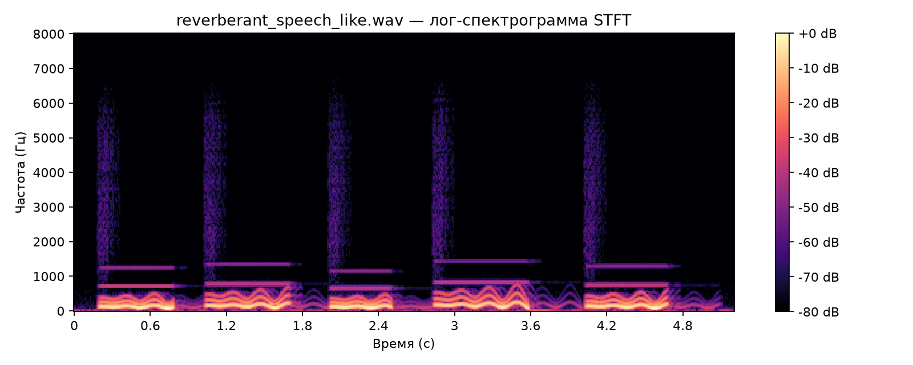
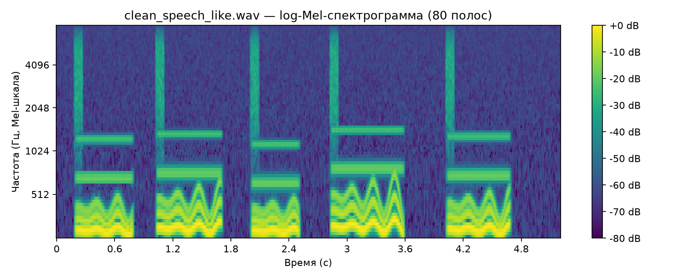
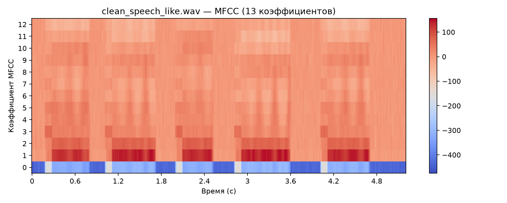
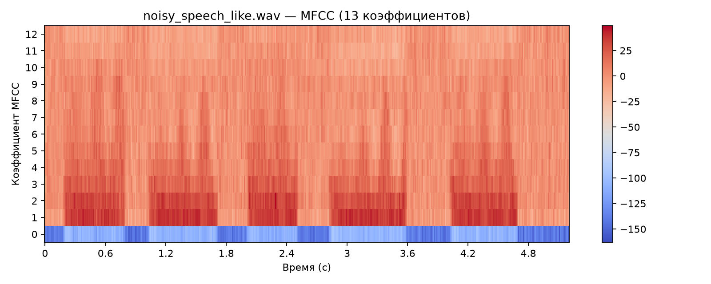
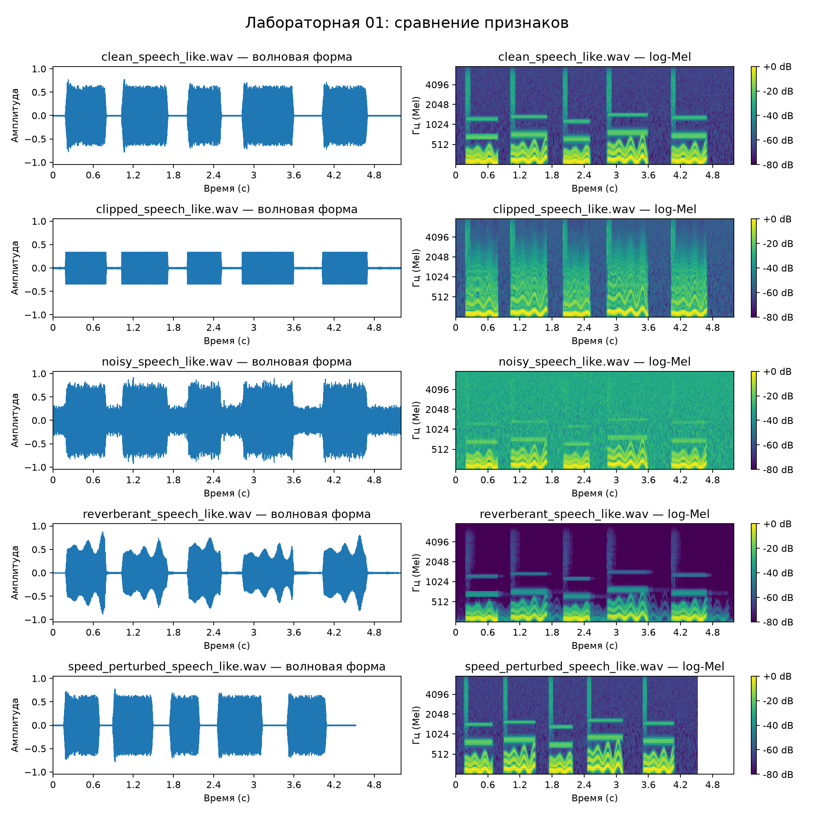

# Лабораторная №1. Анализ аудио: waveform, STFT, log-Mel и MFCC

## Цель и условия эксперимента

Исследовать, как шум, реверберация, клиппинг и ускорение меняют сигнал и его признаки, и связать эти изменения с возможными трудностями распознавания речи.

Источник данных — предоставленный `scripts/make_lab_audio.py`. Это синтетические speech-like сигналы, а не запись естественной речи. Генератор содержит пять тональных сегментов, короткие шумовые всплески и паузы. Начальное значение генератора случайных чисел — 7, для добавленного шума — 8. Файлы записаны в моно WAV PCM_16. ASR-модель в этой работе не запускалась: утверждения об ошибках ASR ниже являются гипотезами, а не результатами измерения WER.

Инструкция воспроизведения: [RUN.md](RUN.md). Условия задания: [LAB_01_DESCRIPTION.md](LAB_01_DESCRIPTION.md).

| Параметр | Значение |
|---|---|
| Частота дискретизации | 16 000 Гц |
| FFT / длина окна | 400 отсчётов = 25 мс |
| Шаг | 160 отсчётов = 10 мс |
| Окно STFT | Hann, с центрированием кадров |
| Частотный шаг FFT | 16 000 / 400 = 40 Гц |
| Mel-полосы | 80, от 20 до 7600 Гц |
| MFCC | 13 коэффициентов |
| STFT / log-Mel в dB | Относительно максимума соответствующего файла; динамический диапазон 80 dB |

При загрузке скрипт приводит звук к моно и 16 кГц. Для сгенерированных файлов это не меняет исходные параметры. При анализе сторонней записи исходную частоту и число каналов следует отдельно проверять по метаданным WAV.

## A. Подготовка аудио и ожидания

Сгенерированы пять вариантов:

- `clean_speech_like.wav` — исходный сигнал, пиковая нормализация до 0,78.
- `noisy_speech_like.wav` — добавление белого шума с целевым SNR 8 dB по мощности всего исходного сигнала, затем пиковая нормализация до 0,92.
- `reverberant_speech_like.wav` — свёртка с затухающей импульсной характеристикой длиной 0,42 с, с отражениями через 45 и 95 мс; нормализация до 0,88. Результат обрезан до исходной длины.
- `clipped_speech_like.wav` — усиление в 2,4 раза и ограничение на уровне ±0,34.
- `speed_perturbed_speech_like.wav` — ресемплинг с отношением 100/115 при сохранении частоты воспроизведения 16 кГц, затем нормализация до 0,78.

**1. Ожидаемая RMS.** При добавлении некоррелированного шума без последующего масштабирования ожидаемая мощность растёт. Однако здесь файлы по-разному нормализованы, а клиппированный вариант дополнительно ограничен. Поэтому уверенно выбрать максимальную RMS по названию искажения нельзя: ответ даёт таблица измерений в части B.

**2. Наиболее заметное искажение формы.** Клиппинг: на увеличенном фрагменте должны появиться плоские верхушки и нижние площадки вместо плавных экстремумов.

**3. Наиболее размытые переходы.** Реверберация: энергия события сохраняется после его окончания и накладывается на последующие события.

## B. Статистика аудио

Числа берутся из [audio_summary.csv](outputs/audio_summary.csv). Доли в CSV находятся в диапазоне 0–1; в таблице ниже они переведены в проценты.

| Файл | Частота, Гц | Длительность, с | Пик | RMS | Доля тишины, % | Доля клиппинга, % |
|---|---:|---:|---:|---:|---:|---:|
| clean | 16000 | 5,200 | 0,780029 | 0,250151 | 38,8930 | 0,0024 |
| noisy | 16000 | 5,200 | 0,920013 | 0,265441 | 7,7200 | 0,0012 |
| reverberant | 16000 | 5,200 | 0,880005 | 0,216411 | 38,5096 | 0,0108 |
| clipped | 16000 | 5,200 | 0,340027 | 0,245213 | 29,8690 | 46,3798 |
| speed perturbed | 16000 | 4,522 | 0,780029 | 0,250186 | 38,9244 | 0,0014 |

Максимальная измеренная RMS — **0,265441 у noisy**, минимальная — **0,216411 у reverberant**. Клиппированный вариант имеет RMS 0,245213, немного ниже чистого (0,250151): предварительное усиление компенсируется ограничением амплитуды.

RMS вычисляется как `sqrt(mean(x**2))`, пиковая амплитуда — `max(abs(x))`. Это безразмерные амплитуды цифрового сигнала, а не физическая громкость в dB SPL.

**Как интерпретировать две доли.** «Доля тишины» — доля отдельных отсчётов с `abs(x) < max(0.02 * peak, 0.0001)`. Она включает пересечения нуля внутри активных сегментов и зависит от пика. «Доля клиппинга» — доля отсчётов с `abs(x) >= min(0.999, 0.98 * peak)`. Это доля околопиковых отсчётов, а не универсальный детектор перегрузки. У неклиппированного сигнала она тоже может быть ненулевой.

**1. Клиппинг.** У ограниченного сигнала много отсчётов на ±0,34, поэтому околопиковая доля резко возрастает. Значение пика меньше 1 не исключает клиппинг: ограничение выполнено до записи WAV. Разница между измеренным пиком и 0,34 связана с квантованием PCM_16.

**2. Самая короткая запись.** Ускоренный вариант: ожидаемая длительность `5.2 / 1.15 ≈ 4.522 с`. Ресемплинг сокращает число отсчётов при неизменной частоте воспроизведения. Он также повышает частоты примерно в 1,15 раза; это не time-stretch с сохранением высоты тона.

**3. Значение тишины для ASR.** Длинные паузы увеличивают объём ненужной обработки, влияют на разбиение записи и временные метки. Некоторые модели могут выдавать текст на шуме или тишине. На практике границы речи лучше оценивать по кадрам или VAD: текущая доля малых отсчётов не равна доле времени без речи.

## C. Волновая форма

**1. Какое искажение легче заметить?** На увеличенном фрагменте особенно нагляден клиппинг; на полном графике шум заметен по заполнению пауз. Общий вид чистого сигнала позволяет выделить пять активных участков и промежутки между ними.

**2. Как выглядит клиппинг?** Положительные и отрицательные экстремумы срезаны и образуют горизонтальные площадки. В этом примере ограничение симметричное, на уровне около ±0,34. При этом высота графика меньше, чем у чистого сигнала: низкий пик не означает отсутствие сильного искажения.

**3. Почему амплитуды недостаточно?** У сигналов с похожей огибающей может быть разное распределение частот и разная последовательность звуков. Waveform показывает время и амплитуду, но не отделяет частотные компоненты. Для этого используются спектрограммы.

## D. Лог-спектрограмма STFT

**1. Где больше широкополосной высокочастотной энергии?** В зашумлённом варианте добавленный белый шум распределён по всему диапазону и заполняет также паузы. У клиппированного сигнала появляются дополнительные гармоники, связанные с активными участками; это отличается от непрерывного шумового фона. У чистого сигнала короткие высокочастотные всплески предусмотрены генератором и сами по себе не являются дефектом записи.

Дополнительная численная проверка по PSD Welch (`nperseg=400`, `noverlap=240`, сумма плотности в полосе 4–8 кГц, умноженная на шаг 40 Гц) дала мощность около 0,004952 для noisy, 0,000217 для clipped и 0,000120 для clean. Это подтверждает наблюдение без сравнения индивидуально нормированных цветов.

**2. Что делает реверберация?** Затухающие копии сигнала продлевают события во времени и ухудшают различимость границ. В данном генераторе импульсная характеристика также сильно меняет спектральный баланс: это упрощённая модель помещения. Длительность файла не увеличивается, потому что хвост свёртки обрезается до исходного числа отсчётов.

**3. Почему возможны замены и удаления?** Шум скрывает слабые акустические признаки: система может спутать похожие звуки или не обнаружить короткий участок речи. Это возможное объяснение, которое в эксперименте с настоящей ASR следовало бы проверять по транскрипциям и метрикам.

Цвет каждой STFT нормирован относительно собственного максимума. Сравнение цвета показывает структуру и относительный контраст внутри записи; для сравнения абсолютной энергии между файлами нужна общая опорная величина.

## E. Log-Mel-спектрограмма

**1. Что видно лучше, чем на waveform?** Можно отличить низкочастотные тональные области от широкополосных всплесков, проследить изменение спектральной огибающей и увидеть, какие частотные области заполняет шум.

**2. Какая информация сжимается?** Мощности соседних FFT-компонентов объединяются в 80 перекрывающихся Mel-полос, особенно широких на высоких частотах. Точные положения узких пиков различимы хуже. При переходе от комплексной STFT к мощности теряется фаза; в показанной амплитудной STFT фаза тоже уже не отображается.

**3. Зачем логарифм?** Он сжимает большой динамический диапазон, позволяет видеть слабые компоненты рядом с сильными и переводит умножение мощности на коэффициент в добавку в логарифмической шкале. Здесь используется `10 * log10` мощности; для амплитуды STFT — `20 * log10`.

Mel-шкала — нелинейное расположение частотных полос. Подписи частотной оси на рисунках указаны в герцах.

## F. MFCC

**1. Визуальное отличие от log-Mel.** Вертикальная ось содержит 13 индексов коэффициентов, а не 80 частотных полос. Значения могут быть положительными и отрицательными. После DCT коэффициент описывает изменение формы логарифмического Mel-спектра по полосам; его нельзя читать как энергию отдельной частоты.

**2. Польза компактного представления.** Меньше признаков означает меньший объём хранения и вычислений. Первые коэффициенты описывают относительно плавную спектральную огибающую; отбрасывание последующих сокращает детали. DCT помогает уменьшить корреляцию признаков, но не гарантирует их независимость для любых данных.

**3. Почему нейросети используют log-Mel?** В 80 полосах сохраняется больше спектральной структуры, чем в 13 MFCC. Модель может обучиться нужным преобразованиям сама, тогда как отброшенные при усечении MFCC детали восстановить из оставшихся коэффициентов нельзя. Это объясняет пользу более богатого входа, но не доказывает его превосходство для каждой системы.

В данном скрипте MFCC вычисляются непосредственно из аудио средствами `librosa`, а log-Mel для рисунка отдельно нормируется к своему максимуму. Поэтому изображённые MFCC не следует считать буквальным DCT от показанной нормированной цветовой матрицы log-Mel. Общая цветовая шкала между отдельными MFCC-графиками не фиксирована.

## G. Сравнение чистого и искажённого аудио

| Искажение | Изменение waveform | Изменение спектрограммы / log-Mel | Возможные ошибки ASR |
|---|---|---|---|
| Шум | Случайные колебания поверх сигнала; паузы заполнены | Широкополосный фон, снижение контраста слабых компонентов | Замены и удаления из-за маскирования; вставки на шумовых паузах |
| Реверберация | Затухание после событий; изменение огибающей | Энергия продлевается во времени; меняется спектральный баланс | Ошибки границ и временных меток; замены при наложении соседних звуков |
| Клиппинг | Плоские площадки около ±0,34, искажённая форма периодов | Дополнительные гармоники, изменение распределения энергии | Замены из-за искажения тембра; удаления плохо различимых звуков |
| Ускорение | Пять сегментов расположены плотнее; запись короче | Сжатие по времени и повышение частот | Пропуски коротких элементов, замены и ошибки тайминга |

Предсказания в последнем столбце относятся к возможному поведению систем на естественной речи. Для этих синтетических сигналов нет текстового эталона, поэтому оценивать WER/CER здесь нельзя.

## Выводы и ограничения

1. Waveform удобен для оценки времени, огибающей и ограничения пиков; спектральные признаки позволяют различать шум, тональные компоненты и последствия искажений.
2. По одному пику, RMS или пороговой доле нельзя сделать полный вывод о качестве: показатели нужно сопоставлять с графиками и способом генерации.
3. Log-Mel сохраняет подробное распределение энергии по полосам, а MFCC даёт компактное описание спектральной огибающей.
4. Сигналы синтетические, реверберация упрощена, шкалы dB относительные, модель ASR не запускалась. Результат — диагностика признаков, а не сравнение точности распознавателей.

Дополнительная личная запись 5–10 секунд не выполнялась; она не входит в обязательные части A–G.

## Технические уточнения к исходным скриптам

- Исправлены пути по умолчанию: убран отсутствующий префикс `updated_course/`.
- Для увеличенного waveform сохранено исходное время фрагмента (0,5–0,6 с).
- В отображение Mel-признаков переданы те же `fmin=20` и `fmax=7600`, что и в расчёт; уточнены единицы оси.
- На графики MFCC добавлены индексы коэффициентов 0–12.
- Для сводного сравнения установлены единые амплитудная и временная шкалы (0–5,2 с); log-Mel показывается в диапазоне −80…0 dB с цветовыми шкалами. Опорный максимум по-прежнему индивидуален для каждого файла. Пустой участок после конца ускоренного файла не является записанной тишиной.
- Генератор сигналов, формулы статистики и параметры извлечения признаков сохранены.
