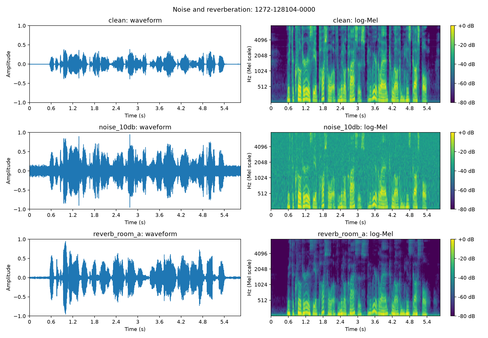
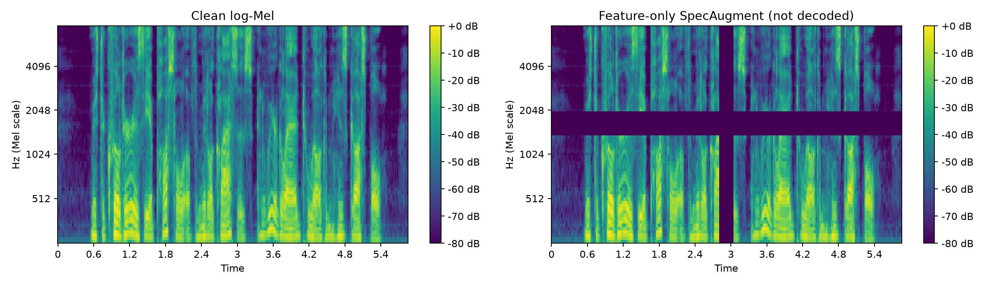
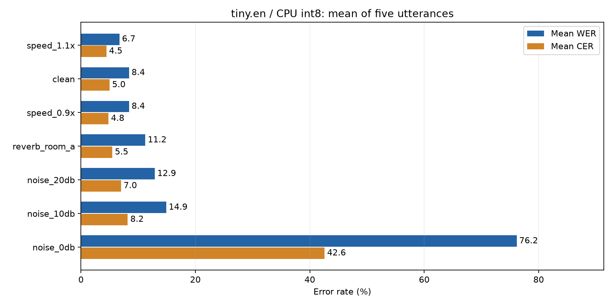

# Лабораторная №2. Аугментация данных и устойчивость ASR

## Цель, данные и методика

Исследовать влияние контролируемых искажений аудио на локальную модель распознавания `tiny.en`. Работа выполнена на пяти записях из предоставленного поднабора LibriSpeech dev-clean: `1272-128104-0000`, `0001`, `0003`, `0006`, `0007`. Это один диктор и одна глава, а не независимая выборка разных голосов и условий. Источник и лицензия сохранены в [DATA_LICENSE.md](data/DATA_LICENSE.md), тексты — в [manifest.jsonl](data/manifest.jsonl).

Условия: `clean`, `noise_20db`, `noise_10db`, `noise_0db`, `reverb_room_a`, `speed_0.9x`, `speed_1.1x`. Всего 5 × 7 = 35 файлов. Исходные файлы — моно, 16 кГц. Seed аугментаций — 17; для шума i-й записи используется seed `17 + i` (нумерация с нуля). Для разных SNR одной записи используется одна и та же реализация шума с разным масштабом.

Модель: `faster-whisper`, `tiny.en`, CPU, `int8`, `language="en"`, `beam_size=1`, `vad_filter=False`; остальные параметры исходного вызова оставлены по умолчанию. Распознавание локальное. SpecAugment применяется только для иллюстрации признаков, в 35 декодируемых условий не входит. Инструкция воспроизведения: [RUN.md](RUN.md).

Формулы метрик:

- `WER = (S + D + I) / N`, где S/D/I — замены, удаления и вставки слов, N — число слов эталона.
- CER — аналогичная доля редакционных операций над символами. В данном скрипте **пробелы и апострофы учитываются**.
- `RTF = decode_seconds / audio_seconds`; значение меньше 1 означает, что измеренное декодирование быстрее длительности аудио.

Одинаковый нормализатор переводит эталон и гипотезу в нижний регистр, заменяет всё кроме `a-z`, цифр и апострофа пробелами, схлопывает повторные пробелы. Он **не приравнивает `Mr.` к `mister`** и не исправляет имена. Поэтому часть ошибок может отражать форму записи слова, а не потерю смысла.

`mean_wer` и `mean_cer` — простое среднее по пяти фразам, а не корпусные показатели с взвешиванием по длине. Поле `mean_rtf`, несмотря на название, вычислено как сумма времён декодирования, делённая на сумму длительностей. Загрузка/создание модели происходит до таймера и не включается в RTF. Один замер без прогрева и повторов не позволяет надёжно ранжировать условия по производительности.

## 1. Два вида аугментаций и наблюдаемые изменения

Выбраны **шум 10 dB** и **реверберация room_a** для записи `1272-128104-0000`.

| Аугментация | Наблюдение по waveform | Наблюдение по log-Mel |
|---|---|---|
| Шум 10 dB | Фон заполняет начальную/конечную паузу и промежутки между словами | Повышается широкополосный фон, особенно заметный на высоких частотах; слабые компоненты менее контрастны |
| Реверберация room_a | Меняется огибающая; после событий сохраняется затухающий сигнал | Переходы растягиваются во времени, усиливается относительное преобладание низких частот |

Все преобразованные варианты нормируются по пику до 0,95, а clean сохраняет исходный уровень. Поэтому увеличившаяся амплитуда на waveform не является отдельным доказательством роста шума или энергии реверберации. Цвет log-Mel также отсчитывается от собственного максимума каждого файла.

## 2. Временное размывание и аддитивное маскирование

При шуме 10 dB широкополосный фон присутствует даже до начала речи и не привязан к окончаниям отдельных звуков. При room_a энергия после речевого события затухает; границы менее резкие, а соседние события могут перекрываться. Именно зависимость хвоста от предшествующего звука согласуется с временным размыванием.

В коде room_a — свёртка с синтетической импульсной характеристикой длиной 0,38 с, экспоненциальным спадом `exp(-10t)` и отражениями через 31, 79 и 143 мс. Это упрощённый фильтр: наряду с временным размыванием он сильно меняет спектральную огибающую. Нельзя приписывать всё ухудшение исключительно эху. Результат свёртки обрезан до исходного числа отсчётов, поэтому длительность файла не увеличивается.

## 3. Скорость и длительность

Источник: [duration_comparison.csv](outputs/results/duration_comparison.csv).

| Запись (последние 4 цифры ID) | Clean, с | 0,9×, с | 1,1×, с |
|---|---:|---:|---:|
| 0000 | 5,855000 | 6,505562 | 5,322750 |
| 0001 | 4,815000 | 5,350000 | 4,377313 |
| 0003 | 9,900000 | 11,000000 | 9,000000 |
| 0006 | 5,640000 | 6,266687 | 5,127313 |
| 0007 | 9,240000 | 10,266687 | 8,400000 |

При коэффициенте скорости `f` длительность становится примерно `T / f`: 0,9× даёт увеличение на 11,11%, 1,1× — уменьшение на 9,09%. Микросекундные отличия от формулы вызваны округлением числа отсчётов при ресемплинге.

Реализация меняет одновременно темп и высоту тона: `resample_poly(audio, 100, round(100*f))` с воспроизведением при прежних 16 кГц. Одна длительность не предсказывает WER, потому что изменяются частоты, длительности отдельных звуков и соответствие обучающим данным модели; роль играют также конкретные слова и решения декодера.

## 4. SpecAugment

Для первой записи log-Mel имеет форму **80 × 586**. Точные параметры сохранены в [specaugment_metadata.json](outputs/figures/specaugment_metadata.json).

- Временная маска: столбцы **281–304 включительно** (`281:305`), 24 кадра с шагом 10 мс; центры кадров от 2,81 до 3,04 с, ширина отображаемой полосы около 0,24 с. Маска охватывает все 80 Mel-полос.
- Частотная маска: строки **35–44 включительно** (`35:45`), 10 Mel-полос на всём временном интервале. Индексы нулевые; это номера полос, а не герцы и не гармоники.
- Замаскированные значения заменены на минимум матрицы **−80 dB**. Аудиофайл не изменён, длина матрицы сохранена.

При обучении скрытие частей спектра может заставлять модель использовать контекст и несколько акустических признаков вместо зависимости от одной узкой области. Однако в этой работе модель не переобучается: по рисунку нельзя заключить, что качество после обучения улучшилось. Слишком большие маски способны скрыть важную информацию.

## 5. Сравнение одной записи: clean и два вида шума

Выбрана запись `1272-128104-0001`. Источник всех чисел и текстов: [per_item_results.csv](outputs/results/per_item_results.csv).

Эталон: **NOR IS MISTER QUILTER'S MANNER LESS INTERESTING THAN HIS MATTER**.

| Условие | WER, % | CER, % | Длительность, с | Декодирование, с | RTF |
|---|---:|---:|---:|---:|---:|
| clean | 10,0000 | 6,3492 | 4,815 | 0,276727 | 0,057472 |
| noise_10db | 30,0000 | 14,2857 | 4,815 | 0,330738 | 0,068689 |
| noise_0db | 110,0000 | 49,2063 | 4,815 | 1,650266 | 0,342734 |

Полученные гипотезы:

- **clean:** “Nor is Mr. Quilter's manner less interesting than his matter.”
- **noise_10db:** “Nor is Mr. Colter's matter less interesting than his matter.”
- **noise_0db:** “Norers, Mr. Court, is now expressed in question when this matters.”

У clean единственная словесная ошибка — `mister → mr`. При 10 dB добавляются `quilter's → colter's` и `manner → matter`. При 0 dB значительная часть фразы потеряна и заменена другой последовательностью слов.

При переходе clean → noise_0db **сильнее всего относительно своего исходного уровня изменился WER: в 11 раз**. CER вырос примерно в 7,75 раза, RTF — в 5,96 раза. Абсолютно WER увеличился на 100 процентных пунктов, CER — на 42,8571 п.п.; процент ошибок и RTF измеряют разные свойства, поэтому сравнивать их абсолютные разности как одну шкалу нельзя.

WER 110% допустим: редакционное расстояние составляет 11 операций при 10 словах эталона, поскольку учитываются также вставки. При сильном шуме маскируются акустические признаки, и декодер выдаёт другую фразу. Повышенное время одного случая может быть связано с дополнительными попытками декодирования при параметрах по умолчанию; их число не логировалось, поэтому причина замедления не установлена.

## 6. Условие с максимальным агрегированным WER

Источник: [aggregate_results.csv](outputs/results/aggregate_results.csv). Каждая строка содержит пять фраз и 82 эталонных слова.

| Условие | mean_WER, % | mean_CER, % | mean_RTF |
|---|---:|---:|---:|
| clean | 8,3958 | 4,9979 | 0,045112 |
| noise_20db | 12,8958 | 7,0029 | 0,044540 |
| noise_10db | 14,8958 | 8,1784 | 0,045192 |
| noise_0db | **76,1564** | **42,5818** | 0,082157 |
| reverb_room_a | 11,2291 | 5,4824 | 0,043951 |
| speed_0.9x | 8,3958 | 4,7959 | 0,040122 |
| speed_1.1x | 6,7291 | 4,4574 | 0,048305 |

Максимальный `mean_wer` у **noise_0db**: 0,761564; `mean_cer` — 0,425818. Рост относительно clean составляет 67,7606 п.п. WER и 37,5839 п.п. CER. Пример сравнения эталона и сильно изменившейся гипотезы для `0001` приведён в разделе 5.

При SNR 0 dB мощности исходного сигнала и добавленного шума до общей нормализации равны. SNR здесь рассчитывается по всей записи, включая паузы, а не только по речевым кадрам. Общая пиковая нормализация одновременно масштабирует сигнал и шум, поэтому сама по себе не улучшает их соотношение. Широкополосный шум особенно мешает слабым компонентам и различению похожих звуков.

Результат не строго монотонен для каждого отдельного слова. Например, `speed_1.1x` улучшил распознавание фамилии в `0006`: `Krilter → Quilter`, снизив WER этой фразы с 16,6667% до 8,3333%. Это одна устранённая ошибка в небольшой выборке, а не доказательство универсальной пользы ускорения.

## 7. Почему WER и CER могут давать разную картину

Наиболее наглядный пример — **reverb_room_a**, запись `1272-128104-0003`.

Эталон: “HE HAS GRAVE DOUBTS WHETHER SIR FREDERICK LEIGHTON'S WORK IS REALLY GREEK AFTER ALL AND CAN DISCOVER IN IT BUT LITTLE OF ROCKY ITHACA”.

| Вариант | Отличия от эталона после нормализации | WER, % | CER, % |
|---|---|---:|---:|
| clean | `leighton's → layton's` | 4,1667 | 3,0075 |
| reverb_room_a | `rocky → wonky`, `ithaca → ithaka`; `leighton's` теперь верно | 8,3333 | 2,2556 |

В эталоне 24 слова и 133 символа с пробелами. Для clean получается одна замена слова и четыре символьные операции. Для room_a — две замены слов, но лишь три символьные операции. Поэтому **WER удваивается, а CER уменьшается**. WER считает неверным слово целиком, независимо от числа изменённых букв; CER чувствителен к величине изменения внутри слова.

Дополнительный пример: `0001` с шумом 10 dB. WER растёт с 10% до 30% (+20 п.п.), CER — с 6,3492% до 14,2857% (+7,9365 п.п.). Замены `manner/matter` и похожие написания фамилии дают целые словесные ошибки при сравнительно небольшом числе символьных изменений.

## 8. Одинаковые ошибки при разных искажениях

**Пример 1: запись `0007`.**

- Эталонный конец: `... is adding more fact`.
- Гипотеза: `... is adding more effect`.
- Ошибка `fact → effect` повторяется у clean, noise_20db, noise_10db, noise_0db, reverb_room_a и speed_1.1x. При speed_0.9x получается `factor`.

Поскольку ошибка есть уже на чистой записи и сохраняется при разных воздействиях, её нельзя объяснить только добавленным шумом или реверберацией. Правдоподобны акустическая неоднозначность окончания и предпочтение языковой части декодера к сочетанию “more effect”. Без альтернативных декодирований и анализа внутренних оценок разделить причины нельзя.

**Пример 2: запись `0001`.**

- Эталонный фрагмент: `quilter's manner less interesting`.
- При noise_10db: `colter's matter less interesting`.
- При reverb_room_a: `quilter's matter less interesting`.

Одинаковая замена `manner → matter` возникает как при шуме, так и при реверберации. Для шума возможна маскировка различающего согласного, для реверберации — размывание переходов; также на выбор могло повлиять слово `matter` в конце фразы. Транскрипции согласуются с этими предположениями, но сами по себе их не доказывают. Ошибки временных меток здесь отдельно не оценивались.

Наконец, повторяемое `mister → mr` в нескольких условиях — пример влияния соглашений записи и нормализатора, а не достаточное свидетельство акустического дефекта.

## 9. Можно ли обобщить высокий WER на любые ASR-системы?

Нет. Высокий WER в данном опыте не доказывает ни универсальную вредность аугментации, ни её непригодность для обучения.

1. **Ограниченность данных:** пять коротких фраз одного диктора из одной главы, один язык, фиксированная реализация шума и упрощённая room_a. Ранжирование может измениться на другом голосе, шуме, языке или наборе фраз. Нет повторов по seed и оценки статистической неопределённости.
2. **Ограниченность модели и протокола:** одна маленькая `tiny.en`, одно квантование и фиксированные параметры декодирования. Другая модель или обучение с этими аугментациями может дать другой результат. Кроме того, нормализатор учитывает орфографические различия вроде `Mr.`/`mister` как ошибки.

Ухудшение при добавлении искажения на этапе проверки и польза того же искажения как средства обучения — разные вопросы. В этой лабораторной измеряется только первое.

## Воспроизведение и изменения в исходном коде

Полный запуск завершён: 35 вариантов распознаны, получены 35 строк детальных и 7 строк агрегированных результатов. Проверенные версии и сведения о модели сохранены в [requirements-lock.txt](requirements-lock.txt) и [experiment_metadata.json](outputs/experiment_metadata.json).

- Формулы аугментаций, нормализатор, WER/CER, агрегация и настройки распознавания сохранены.
- На графиках исправлен диапазон Mel-оси (`20–7600 Гц`), унифицированы шкалы waveform и dB, добавлены обозначения условий.
- Параметры SpecAugment дополнительно сохраняются в JSON.
- В распознаватель добавлен вывод прогресса и текстов; в `summarize_experiment.py` — таблица длительностей, сравнение noise/reverb и график метрик.
- Веса модели и виртуальное окружение хранятся локально и исключены из Git.
