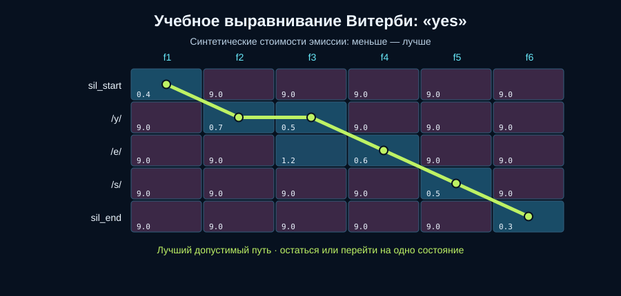

# Лабораторная №3. Классическое выравнивание и N-граммная языковая модель

## Цель и реализация

Реализованы недостающие вычисления алгоритма Витерби, биграммной модели со сглаживанием add-k и объединения акустической и языковой оценок. В трёх исходных модулях заполнены отмеченные пропуски. Проверки входных данных, токенизация, обучение, обратный проход Витерби, сортировка, запускающий скрипт и исходные данные не изменены.

Акустические стоимости и оценки кандидатов синтетические. Работа демонстрирует алгоритмы, а не качество настоящего распознавателя речи. Для запуска достаточно Python 3.10+ и стандартной библиотеки; использован Python 3.13.5.

## Схема прохождения данных

| Функция | Вход | Выход / назначение |
|---|---|---|
| `viterbi_align` | Матрица 6 кадров × 5 состояний из `toy_alignment_costs.json`, начальное состояние 0 и конечное 4 | Список индексов состояний по кадрам и минимальная суммарная стоимость |
| `BigramLM.train` | 7 предложений `toy_lm_corpus.txt`, k = 0,5 | Словарь, счётчики биграмм и контекстов, объект языковой модели |
| `bigram_probability` | Предыдущее слово h и текущее слово w | Сглаженная вероятность P(w\|h) с отображением неизвестных слов в `<unk>` |
| `sentence_logprob` | Текст гипотезы | Сумма десятичных логарифмов вероятностей от `<s>` до `</s>` |
| `rank_candidates` | Кандидаты с акустическими и языковыми оценками, вес λ | Новые записи с объединёнными оценками, отсортированные по убыванию |
| `run_lab` | Папки входных данных и результатов | SVG выравнивания, два CSV и `summary.json` |

Выравнивание и ранжирование кандидатов в этом примере — две отдельные демонстрации. Стоимость Витерби не передаётся напрямую в акустические оценки кандидатов.

## A. Выравнивание Витерби

Состояния: `sil_start → /y/ → /e/ → /s/ → sil_end`. На первом кадре достижим только `sil_start`; на следующем шаге допустимо остаться или перейти ровно в следующее состояние. Пропуски и возвраты запрещены.

Рекуррентное вычисление:

```text
D[t, s] = cost[t, s] + min(D[t-1, s], D[t-1, s-1])
```

Для начального состояния второго предшественника нет. Сначала в список вариантов добавляется «остаться», затем «продвинуться». `min` сравнивает накопленную стоимость; при равенстве выбирает первый вариант, поэтому сохраняется требуемый приоритет «остаться». В `back[t][s]` записывается индекс выбранного предшественника, чтобы восстановить весь путь от последнего кадра к первому.



Полученный путь: **`sil_start, /y/, /y/, /e/, /s/, sil_end`**, индексы **`[0, 1, 1, 2, 3, 4]`**.

Источник: [alignment_path.csv](outputs/alignment_path.csv).

| Кадр | Состояние | Стоимость эмиссии | Накопленная стоимость | Действие |
|---|---|---:|---:|---|
| f1 | sil_start | 0,4 | 0,4 | Начало |
| f2 | /y/ | 0,7 | 1,1 | Перейти |
| f3 | /y/ | 0,5 | 1,6 | Остаться |
| f4 | /e/ | 0,6 | 2,2 | Перейти |
| f5 | /s/ | 0,5 | 2,7 | Перейти |
| f6 | sil_end | 0,3 | **3,0** | Перейти |

Альтернативный путь `[0, 1, 2, 2, 3, 4]` соответствует `sil_start, /y/, /e/, /e/, /s/, sil_end`. Его стоимость, проверенная суммированием исходной матрицы:

```text
0,4 + 0,7 + 1,2 + 0,6 + 0,5 + 0,3 = 3,7
```

Различие только на f3: альтернатива раньше переходит в `/e/` и платит 1,2 вместо 0,5. Лучший путь остаётся в `/y/` и выигрывает 0,7. Накопленные стоимости альтернативы: 0,4; 1,1; 2,3; 2,9; 3,4; 3,7.

Выбор минимальной ячейки отдельно для каждого кадра не гарантирует допустимый путь в произвольной матрице. Витерби минимизирует стоимость с учётом ограничений переходов. Его сложность для T кадров и S состояний — O(TS) по времени; данная реализация хранит O(TS) значений и обратных указателей.

## B. Биграммная языковая модель

В корпусе восемь различных обычных слов:

```text
coffee, drink, green, like, strong, tea, they, we
```

С учётом `<unk>` и `</s>` размер предсказываемого словаря **|V| = 10**. `<s>` не включается: он служит только начальным контекстом. Счётчики хранятся в `bigram_counts[(h, w)]` и `context_counts[h]`.

Для k = 0,5:

```text
P(w | h) = (C(h,w) + 0,5) / (C(h) + 0,5 × 10)
```

**Ручной подсчёт для контекста drink.** Он встречается в строках 1, 2, 5 и 7 корпуса: C(drink) = 4. В трёх случаях после него стоит `green`, в одном — `strong`. Знаменатель равен `4 + 5 = 9`.

| Следующее слово | C(drink, w) | P(w\|drink) |
|---|---:|---:|
| green | 3 | 3,5 / 9 ≈ 0,388889 |
| strong | 1 | 1,5 / 9 ≈ 0,166667 |
| Каждое из остальных восьми слов словаря | 0 | 0,5 / 9 ≈ 0,055556 |

Сумма вероятностей: `(3,5 + 1,5 + 8 × 0,5) / 9 = 1`. Ненаблюдавшиеся биграммы получают ненулевую вероятность благодаря сглаживанию.

**Оценки предложений.** Учитываются пять переходов для каждой четырёхсловной гипотезы, включая последний переход в `</s>`.

| Переход / вероятность | we drink green tea | we drink strong coffee |
|---|---:|---:|
| P(we\|`<s>`) | 4,5 / 12 | 4,5 / 12 |
| P(drink\|we) | 2,5 / 9 | 2,5 / 9 |
| P(green или strong\|drink) | 3,5 / 9 | 1,5 / 9 |
| P(tea\|green) или P(coffee\|strong) | 5,5 / 10 | 2,5 / 7 |
| P(`</s>`\|tea или coffee) | 5,5 / 10 | 2,5 / 7 |
| **Сумма log₁₀ вероятностей** | **−1,911720319** | **−2,654738546** |

Например, для чайной гипотезы результат равен:

```text
log10((4,5/12) × (2,5/9) × (3,5/9) × (5,5/10) × (5,5/10))
= −1,911720319
```

**Незнакомые слова.** Слово `cocoa` отсутствует в словаре, поэтому преобразуется в `<unk>` и как целевое слово, и как последующий контекст. Например, `P(cocoa|drink) = P(<unk>|drink) = 0,5/9`. Контекст `<unk>` в обучении не встречался, поэтому `P(</s>|<unk>) = 0,5/5 = 0,1`. Для предложения из одного слова `cocoa` оценка равна `log10((0,5/12) × 0,1)`; переход в конец предложения сохранён. Эти случаи включены в тесты.

## C. Комбинация акустической и языковой оценок

Использована формула:

```text
combined_log_score = acoustic_log_score + λ × lm_log_score
```

Здесь большее значение лучше: −1 лучше −2. Это противоположно интерпретации отрицательных лог-стоимостей в части A, где меньшая стоимость лучше. Объединённая оценка используется для ранжирования; сама по себе она не является нормированной вероятностью по кандидатам.

Источник: [candidate_scores.csv](outputs/candidate_scores.csv).

| λ | Место | Гипотеза | Акустическая | Языковая | Объединённая |
|---:|---:|---|---:|---:|---:|
| 0 | 1 | we drink strong coffee | −1,000000 | −2,654739 | −1,000000 |
| 0 | 2 | we drink green tea | −1,200000 | −1,911720 | −1,200000 |
| 0,5 | 1 | we drink green tea | −1,200000 | −1,911720 | −2,155860 |
| 0,5 | 2 | we drink strong coffee | −1,000000 | −2,654739 | −2,327369 |
| 1 | 1 | we drink green tea | −1,200000 | −1,911720 | −3,111720 |
| 1 | 2 | we drink strong coffee | −1,000000 | −2,654739 | −3,654739 |

При λ = 0 влияет только акустическая оценка: выигрывает кофе. Языковая модель предпочитает чайную гипотезу из-за частот биграмм корпуса. Она выигрывает у кофейной по языковому баллу на 0,743018227, но проигрывает по акустическому на 0,2. Разница объединённых баллов «чай минус кофе»:

```text
−0,2 + λ × 0,743018227
```

Порог смены лидера — **λ ≈ 0,2691724**. Поэтому при 0,5 и 1,0 лидирует `language_favorite`. При точном равенстве Python сохраняет исходный порядок кандидатов благодаря стабильной сортировке.

Числа CSV округлены до шести знаков после запятой; расчёты выполняются до округления. Поэтому ручная комбинация уже округлённых столбцов может отличаться на последний знак.

## Ответы на контрольные вопросы

1. **Низкая и высокая стоимость на карте.** Ячейки `(f1, sil_start) = 0,4` и `(f6, sil_end) = 0,3` имеют низкие стоимости; `(f1, /e/) = 9,0` — высокую. Цвет и число показывают локальную стоимость эмиссии состояния на кадре, а не накопленную стоимость пути. Допустимость переходов накладывается отдельно: не каждая ячейка достижима.
2. **Остаться и перейти.** `f2 → f3`: `/y/ → /y/`, остаться. `f3 → f4`: `/y/ → /e/`, перейти на одно состояние. Зелёная линия показывает весь лучший путь.
3. **Сравнение путей.** Последняя строка [alignment_path.csv](outputs/alignment_path.csv) содержит 3,000. В [summary.json](outputs/summary.json) указаны 3,0 и 3,7; прямой подсчёт альтернативы подтверждает 3,7. Выигрыш 0,7 возникает на f3.
4. **Первые места.** При λ = 0: `we drink strong coffee`, акустическая −1,000000, языковая −2,654739, объединённая −1,000000. При λ = 0,5: `we drink green tea`, акустическая −1,200000, языковая −1,911720, объединённая −2,155860.
5. **Почему лидер меняется.** При нулевом весе языковая модель не участвует. Уже при λ > 0,2691724 её преимущество для чайной гипотезы превышает акустический проигрыш 0,2. При λ = 1,0 лидер остаётся тем же. Это предпочтение на маленьком обучающем корпусе, а не доказательство того, что в реальном аудио произнесена именно эта фраза.

## Проверка результата

Добавлены [12 тестов стандартной библиотеки unittest](tests/test_lab_03.py). Все прошли:

- Лучший путь и альтернативная стоимость на данных задания.
- Приоритет «остаться» при равных оценках, произвольные начальное/конечное состояния, один кадр и недопустимые входы.
- Сравнение минимальной стоимости Витерби с **полным перебором всех допустимых путей на 40 небольших случайных матрицах**.
- Ручные частоты биграмм, сумма вероятностей 1, неизвестные слова, конец предложения и десятичные логарифмы.
- Смена победителя при изменении веса и отсутствие изменения входных кандидатов.
- Совпадение всех четырёх артефактов с `outputs_reference`: CSV, JSON и SVG, с нормализацией переводов строк при чтении.

Команды запуска и состав результатов: [RUN.md](RUN.md).
